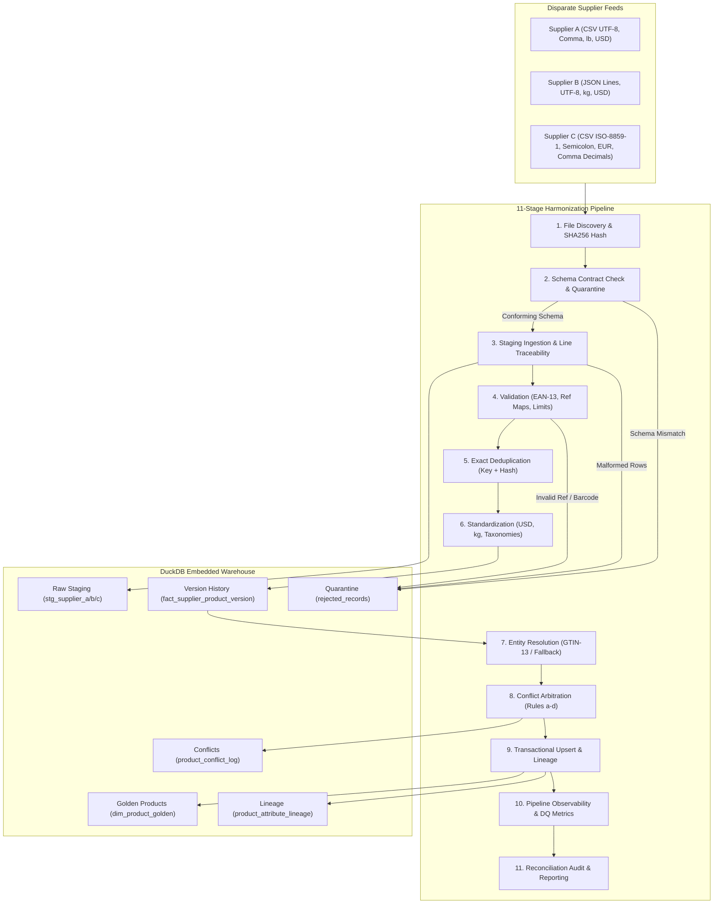

# Supplier Feed Harmonizer

[](https://www.python.org/downloads/)
[](https://duckdb.org/)
[](LICENSE)
[]()
[]()

A production-grade, local, zero-cloud data engineering pipeline that standardizes heterogeneous product feeds across disparate suppliers, resolves cross-supplier attribute conflicts deterministically, and preserves source-level traceability down to the specific file, row, and run that produced every value.

---

## Table of Contents
1. [Architecture Overview](#1-architecture-overview)
2. [Repository Layout](#2-repository-layout)
3. [Prerequisites & Clean Setup](#3-prerequisites--clean-setup)
4. [Step-by-Step Quickstart](#4-step-by-step-quickstart)
5. [Target Warehouse Model & Traceability](#5-target-warehouse-model--traceability)
6. [Identifier & Hashing Conventions](#6-identifier--hashing-conventions)
7. [Conflict Resolution Rules](#7-conflict-resolution-rules)
8. [Retry, Restart & Backfill Mechanics](#8-retry-restart--backfill-mechanics)
9. [Running Tests & Audit Verification](#9-running-tests--audit-verification)
10. [Scale Benchmark (120,000+ Rows)](#10-scale-benchmark-120000-rows)
11. [Assumptions, Limitations & Next Steps](#11-assumptions-limitations--next-steps)

---

## 1. Architecture Overview

The pipeline ingests heterogeneous supplier feeds (CSV with comma delimiter in USD, JSON Lines in USD, and semicolon-delimited CSV with European comma decimals in EUR), enforces contract schemas, quarantines invalid files, validates business constraints, standardizes currencies and units, performs cross-supplier barcode entity resolution, arbitrates attribute conflicts, and publishes to an embedded DuckDB analytical warehouse.



---

## 2. Repository Layout

```text
supplier-feed-harmonizer/
├── README.md                          # Comprehensive project documentation
├── DESIGN_NOTES.md                    # Engineering trade-offs, architecture choices
├── AI_USAGE.md                        # AI usage transparency disclosure
├── Makefile                           # Unified build and automation targets
├── requirements.txt                   # Pinned dependency specifications
├── pytest.ini                         # Test runner configuration
├── .gitignore                         # Build and artifact exclusions
│
├── config/
│   ├── pipeline.yaml                  # Core pipeline orchestrator settings
│   ├── suppliers/
│   │   ├── supplier_a.yaml            # Supplier Alpha contract (CSV UTF-8)
│   │   ├── supplier_b.yaml            # Supplier Beta contract (JSON Lines)
│   │   └── supplier_c.yaml            # Supplier Gamma contract (CSV ISO-8859-1)
│   └── mappings/
│       ├── category_map.csv           # Category taxonomy cross-reference
│       ├── unit_map.csv               # Mass conversion factors to kg
│       ├── color_map.csv              # Color vocabulary mapping
│       ├── currency_map.csv           # Static exchange rates to USD
│       └── country_map.csv            # Country name to ISO-2 codes
│
├── docs/
│   ├── architecture.md                # System diagrams and component flow
│   ├── data_dictionary.md             # Schema specification for all tables
│   ├── reconciliation_report.md       # Generated audit reconciliation report
│   ├── reconciliation_metrics.csv     # Generated tabular metrics summary
│   ├── performance.md                 # Scalability benchmark report (120k rows)
│   └── test_evidence.txt              # Pytest test execution evidence
│
├── src/harmonizer/
│   ├── __init__.py                    # Module version
│   ├── cli.py                         # CLI entrypoint (run & report)
│   ├── config.py                      # Strongly-typed configuration loader
│   ├── ids.py                         # Deterministic IDs, GTIN & file hashing
│   ├── logging_setup.py               # Structured logging with run_id
│   ├── schema_check.py                # Schema contract verification & quarantine
│   ├── ingest.py                      # Staging ingestion & line-level errors
│   ├── validate.py                    # Row validation & error code attribution
│   ├── transform.py                   # Deduplication & standardization
│   ├── resolve.py                     # Entity resolution & conflict rules
│   ├── publish.py                     # DuckDB DDL & transactional upsert
│   ├── runlog.py                      # Pipeline execution run logging
│   └── report.py                      # Conservation audit & SQL analytics
│
├── scripts/
│   ├── generate_data.py               # Deterministic synthetic feed generator
│   └── benchmark.py                   # 120,000+ row scale benchmark runner
│
├── sample_data/
│   ├── input/                         # Starter synthetic feeds (committed)
│   ├── expected/                      # labels.json (ground-truth labels)
│   └── output/                        # Sample committed DuckDB output
│
└── tests/                             # Comprehensive 34-test suite
    ├── test_ids.py                    # Barcodes, keys, and hashing
    ├── test_validation_and_schema.py  # Quarantine, bounds, formats, error codes
    ├── test_transforms_and_units.py   # Unit & currency conversions, dedup
    ├── test_conflict_resolution.py    # Conflict rules a-d and lineage
    └── test_pipeline_e2e.py           # Integration, late versions, recovery
```

---

## 3. Prerequisites & Clean Setup

- **Python**: 3.11, 3.12, or 3.13
- **Git** installed locally
- Zero cloud accounts, zero secrets, zero external network access required.

### Setup Instructions
From a clean terminal / clone:

```bash
# 1. Clone repository
git clone <repo_url>
cd supplier-feed-harmonizer

# 2. Create virtual environment
python -m venv .venv

# 3. Activate virtual environment
# On Linux/macOS:
source .venv/bin/activate
# On Windows (PowerShell):
.venv\Scripts\Activate.ps1
# On Windows (cmd):
.venv\Scripts\activate.bat

# 4. Install pinned requirements
pip install -r requirements.txt
```

---

## 4. Step-by-Step Quickstart

You can use the provided `Makefile` (or invoke Python commands directly):

### 1. Generate Starter Sample Data
Generates ~300 rows across all three suppliers with intentional edge cases, boundary values, malformed lines, schema corruptions, and ground-truth answer labels:
```bash
make sample
# OR: python scripts/generate_data.py --rows 300 --seed 42 --out sample_data/input
```

### 2. Run the Harmonization Pipeline
Executes all 11 stages and persists to DuckDB:
```bash
make run
# OR: python -m src.harmonizer.cli run --input-dir sample_data/input --db-path output/harmonizer.duckdb
```

### 3. Generate the Audit & Reconciliation Report
Audits row conservation laws, referential integrity, price aggregates, error code distributions, and executes 5 analytical sample queries:
```bash
make report
# OR: python -m src.harmonizer.cli report --db-path output/harmonizer.duckdb --out-markdown docs/reconciliation_report.md --out-csv docs/reconciliation_metrics.csv
```

### 4. Run the Full Test Suite
Executes 34 tests with coverage reporting and writes `docs/test_evidence.txt`:
```bash
make test
# OR: python -m pytest -v --cov=src.harmonizer --cov-report=term-missing tests/
```

### 5. Run the Scalability Benchmark
Generates 120,000+ rows, runs the pipeline, measures throughput (rows/sec), and writes `docs/performance.md`:
```bash
make bench
# OR: python scripts/benchmark.py --rows 120000 --seed 42
```

---

## 5. Target Warehouse Model & Traceability

All tables reside in the embedded DuckDB database (`output/harmonizer.duckdb`).

### Schema Summary
- **Reference Dimensions**: `ref_category`, `ref_unit`, `ref_color`, `ref_currency`, `ref_country`.
- **Supplier Dimension**: `dim_supplier(supplier_id, supplier_name, priority_rank, trust_weight)`.
- **Raw Staging Layer**: `stg_supplier_a`, `stg_supplier_b`, `stg_supplier_c` containing raw feed strings plus metadata columns: `_run_id`, `_source_file`, `_source_row_number`, `_ingested_at`.
- **Version History**: `fact_supplier_product_version`. Grain: one row per supplier SKU per distinct `source_updated_at`. **Append-only immutable history**; older arriving data never overwrites newer history.
- **Golden Catalog**: `dim_product_golden`. Grain: one row per canonical real-world product.
- **Attribute Lineage**: `product_attribute_lineage`. Answers *"Why is this value what it is, and where did it come from?"* Contains winning supplier, source file, source row number, run ID, applied rule, and candidate alternatives.
- **Conflict Log**: `product_conflict_log`. Logs every attribute disagreement across suppliers.
- **Quarantine**: `rejected_records`. Every invalid row traceable to source file, line number, raw record, and stable error code.
- **Observability**: `pipeline_runs`, `processed_files`, `dq_metrics`.

For full column-by-column type specifications, refer to [docs/data_dictionary.md](file:///c:/Users/koush/OneDrive/Desktop/supplier-feed-harmonizer/docs/data_dictionary.md).

---

## 6. Identifier & Hashing Conventions

All identifiers are deterministic and reproducible:
- **`product_id`**: `'prd_'` + first 16 hex characters of `sha256(normalized GTIN)`. If GTIN is absent: `'prd_'` + first 16 hex of `sha256(supplier_id | normalized_brand | normalized_name)`.
- **`supplier_product_key`**: `sha256(supplier_id | supplier_sku)`.
- **`record_hash`**: `sha256` digest of normalized business fields (`sku`, `name`, `category`, `price`, `weight`, `color`, `stock`, `country`, `gtin`).
- **`reject_id`**: `sha256(run_id | source_file | source_row_number)`.
- **`run_id`**: `run_YYYYMMDDTHHMMSSZ_<6 hex>` (e.g. `run_20261029T185229Z_d830c6`).
- **Timestamps**: All stored timestamps are ISO-8601 UTC strings (`YYYY-MM-DDTHH:MM:SS+00:00`).
- **Naming Style**: `snake_case` strictly used across all tables and column names.

---

## 7. Conflict Resolution Rules

When multiple suppliers provide conflicting attribute values for the same unified product:
1. **Price (`price_usd`) & Stock (`total_stock`)**: **Rule (a)** - Most recent valid `source_updated_at` wins. Ties broken by supplier priority.
2. **Name (`name_std`), Category (`category_id`), Color (`color_id`), Country (`country_code`)**: **Rule (b)** - Supplier `priority_rank` wins (Rank 1 > Rank 2 > Rank 3).
3. **Weight (`weight_kg`)**: **Rule (c)** - Majority value among suppliers wins. Ties broken by supplier priority rank.
4. **Null Handling**: **Rule (d)** - Null / empty values **never** override existing non-null values.
5. **Backfill Protection**: When older historical feeds arrive late, `latest_source_updated_at` logic ensures that older historical values never overwrite newer golden catalog values.

---

## 8. Retry, Restart & Backfill Mechanics

### Safe Reruns (Idempotency)
- Before processing any file, its `SHA-256` content hash is checked in `processed_files`.
- If the file has already been successfully committed (`status = 'success'` or `'success_empty'`), the pipeline logs a notice and **skips the file**.
- Rerunning the command on unchanged inputs creates **zero duplicate rows** and **zero data alterations**.

### Restart After Crash
- Ingestion and fact/reject persistence execute inside an explicit atomic transaction per file batch.
- If a pipeline process crashes or fails mid-run, the current transaction is **rolled back**.
- Already-committed files remain marked `success`; uncommitted files remain pending and will be retried on the next run.

### Backfills & Historical Loads
- Use `--input-dir <historical_dir>` to ingest older feeds.
- The `fact_supplier_product_version` table appends all historical versions into their proper chronological positions.
- The golden catalog only updates attributes if the incoming feed's timestamp is newer than current golden records.

### Testing Partial Failure & Recovery
- The pipeline provides an injected failure hook via parameter or environment variable:
  ```bash
  # Injects an intentional failure when encountering files matching pattern
  python -m src.harmonizer.cli run --input-dir sample_data/input --fail-on-file fail
  ```

---

## 9. Running Tests & Audit Verification

The repository contains 34 comprehensive tests implemented in `pytest`, verifying all edge cases:
- Schema contracts (empty file, header-only, renamed column, missing column, extra column)
- Parsing & validation (malformed CSV row count, corrupt JSON line, missing required, negative price, zero weight boundary, bad date, bad GTIN checksum, invalid reference keys)
- Deterministic IDs and GTIN-13 checksum math
- Conversions (lb to kg, EUR to USD, decimal comma parsing, ISO-8859-1 German accents)
- Cross-supplier conflict rules a, b, c, d
- Out-of-order & late-arriving records
- Partial failure rollback & retry
- End-to-end reconciliation and conservation assertions

Run tests:
```bash
python -m pytest -v --cov=src.harmonizer --cov-report=term-missing tests/
```
Evidence is preserved in [docs/test_evidence.txt](file:///c:/Users/koush/OneDrive/Desktop/supplier-feed-harmonizer/docs/test_evidence.txt).

---

## 10. Scale Benchmark (120,000+ Rows)

The pipeline incorporates set-based batched array binding and pre-loaded in-memory lookup hashing, achieving high throughput without row-by-row interpreter bottlenecks.

### Benchmark Results (120,015 Rows)
- **Host**: 12-core x86_64 CPU, Windows 11, Python 3.13, DuckDB 1.1.3
- **Total Ingested Rows**: 120,015 rows
- **Valid Rows**: 114,752 rows
- **Rejected Records**: 5,009 rows
- **Dropped Duplicates**: 254 rows
- **Row Conservation**: $114,752 + 5,009 + 254 = 120,015$ (**PASS**)
- **Golden Catalog Products**: 20,002 unified products
- **Attribute Lineage Records**: 140,014 records ($20,002 \times 7$ attributes)
- **Attribute Conflicts Arbitrated**: 77,112 conflicts
- **Throughput**: **1,620.0 rows/second**

Full timing breakdown and optimization comparisons are documented in [docs/performance.md](file:///c:/Users/koush/OneDrive/Desktop/supplier-feed-harmonizer/docs/performance.md).

---

## 11. Assumptions, Limitations & Next Steps

### Assumptions
1. **GTIN Validity**: GTIN-13 (EAN-13) check digits are validated using the standard modulo-10 algorithm. Rows with bad checksums are rejected under `BAD_GTIN`.
2. **Missing Barcodes**: Products without GTIN barcodes are treated as valid unbarcoded items and matched via normalized brand and name with `match_confidence = 'low'`.
3. **Static Currency Rates**: Currency conversion uses a fixed reference exchange rate table (`currency_map.csv`) to ensure 100% offline determinism.

### Known Limitations
- Single-node execution: DuckDB operates as an in-process database, limited to single-node memory and disk bandwidth.
- Static taxonomies: Reference categories must be added to `category_map.csv` in advance; unmapped categories are rejected under `REF_KEY_INVALID`.

### Possible Next Steps
- Implement fuzzy matching with token-based Levenshtein distance for low-confidence fallback products with human-in-the-loop review queues.
- Add streaming Parquet export targets for downstream integration with Apache Iceberg or Delta Lake.
- Add OpenTelemetry metrics emission for real-time Prometheus dashboards.
