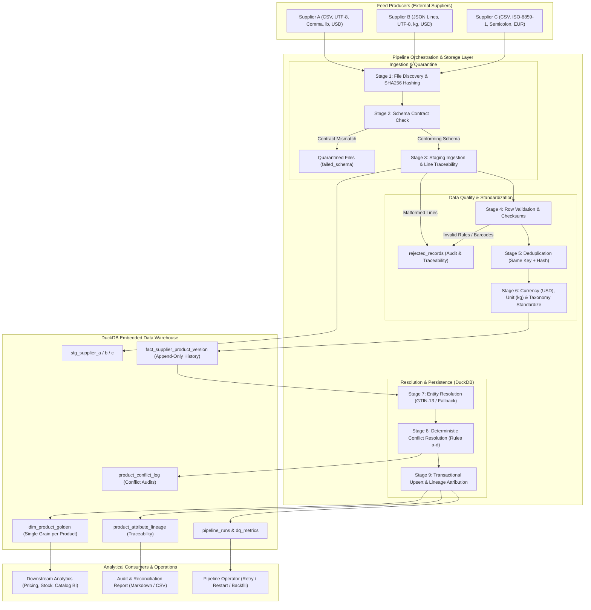

# System Architecture: Supplier Feed Harmonizer

## 1. High-Level Architecture Overview

The `supplier-feed-harmonizer` pipeline processes disparate, heterogeneous supplier feeds (CSV, JSON Lines, ISO-8859-1 semicolon-separated files) into a standardized, unified golden catalog inside an embedded DuckDB database. The architecture is built around two core pillars: **absolute source-level traceability** (every single golden attribute links directly to its source file, row, and run) and **idempotent transactional processing**.

---

## 2. Pipeline Actors

1. **Data Engineer**: Maintains pipeline code, YAML contracts, taxonomy reference tables, and reconciliation assertion logic.
2. **Supplier File Producers**: Upstream external partners publishing catalog feeds in diverse encodings, formats, and schedules without central coordination.
3. **Storage & Processing Layer (DuckDB)**: Embedded, high-performance columnar engine maintaining ACID transactions, staging tables, immutable version history, and golden catalog views.
4. **Analytical Consumer**: BI analysts, pricing algorithms, and ERP systems querying unified catalog attributes with guaranteed referential integrity.
5. **Pipeline Operator**: Monitors runs, investigates `rejected_records` and `pipeline_runs`, and triggers retries, restarts, or backfills via the CLI.

---

## 3. Data Flow & Transaction Boundaries

Each feed file undergoes transactional boundary protection:
1. **Pre-Ingest Hashing**: Files are hashed (`SHA-256`). If already recorded as `success` in `processed_files`, the file is safely skipped.
2. **Batch Transaction**: Ingestion into `stg_*`, `rejected_records`, and `fact_supplier_product_version` executes inside a single atomic DuckDB transaction (`con.begin()` ... `con.commit()`).
3. **Rollback Guarantee**: Any unhandled exception aborts the file batch (`con.rollback()`), preventing partial data contamination. `processed_files` is only marked `success` after a successful commit.
4. **Cross-Supplier Entity Resolution**: Considers all current versions across suppliers, deterministically arbitrates conflicting values, updates `dim_product_golden`, and records lineage per attribute.
